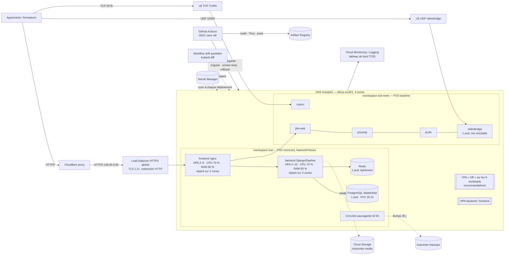

# TCiD Center sur GKE Autopilot — autoscaling, auto-healing, coûts et DevSecOps

Document technique (soutenance Master 2 ASR, ENI). Il décrit l'état audité de
la plateforme `tcid-madagascar.com`, l'architecture cible, ce qui a été
modifié et comment le vérifier.

## 1. Audit de l'existant (30/10/2026, avant modifications)

| Élément | Constat |
|---|---|
| Cluster | `tcid-cluster`, **GKE Autopilot** confirmé, régional `africa-south1`, version 1.36, canal *regular* |
| Nœuds | 1 seul nœud (zone `africa-south1-c`) : Autopilot regroupe les pods, la contrainte de zone était en `ScheduleAnyway` donc non appliquée |
| Metrics Server | opérationnel (`v1beta1.metrics.k8s.io` = True), `kubectl top` fonctionne |
| HPA | backend 2–10 et frontend 2–6, CPU 70 % seulement, pas de politique de montée |
| VPA | un seul VPA (backend), mode `Off` |
| Requests facturées | **3,75 vCPU et 6,06 GiB** réservés pour une consommation réelle de **≈ 0,05 vCPU et 0,85 GiB** |
| Sidecar GCS FUSE | 250m CPU / 256 Mi **par pod** (valeur par défaut), soit 1 vCPU sur 4 pods pour un usage de 1m |
| Sondes | readiness partout ; liveness manquante sur Redis, prosody, jicofo, jitsi-web, coturn ; pas de startupProbe sur PostgreSQL |
| PDB | backend et frontend (minAvailable 1) |
| Déploiement | `replicas: 2` dans les manifests : chaque déploiement remettait le backend à 2 même si l'HPA en avait lancé 6 |
| Sauvegarde | CronJob quotidien ; la mise en pause par `stop-tcid` n'était pas annulée par un déploiement CI |
| Ingress | le certificat d'origine (`tcid-origin-tls`) avait été ajouté à la main : écart entre Git et le cluster |
| CI/CD | tests → kubeconform → build → Trivy → push → déploiement → smoke tests ; **pas de rollback automatique**, pas de sauvegarde avant migration |
| Observabilité | Cloud Logging (system + workloads), Cloud Monitoring avec les paquets cAdvisor, kubelet, DCGM (GPU) et JobSet facturés à l'échantillon |
| Haute dispo PostgreSQL | **non** : un seul pod sur un disque zonal (pd-balanced 20 Gi). Les sauvegardes quotidiennes et avant arrêt existent |

### Pourquoi la plateforme coûte encore quand elle est arrêtée

Quand `stop-tcid.sh` a mis tous les pods à zéro, Autopilot ne facture plus
aucun pod. Ce qui reste facturé :

1. **Frais de gestion du cluster** (≈ 0,10 $/h, soit ≈ 73 $/mois) : couverts
   par le crédit gratuit GKE (≈ 74 $/mois par compte de facturation) **si**
   c'est le seul cluster du compte. À vérifier dans *Facturation > Rapports*,
   ligne « Autopilot cluster management fee » et colonne crédits.
2. **Règles de transfert des 3 load balancers** (HTTPS global, UDP
   videobridge, TCP TURN) : facturées à l'heure, même sans trafic.
3. **Adresses IP statiques** et **disque PostgreSQL** (20 Gi).
4. **Métriques** cAdvisor/kubelet envoyées à Managed Prometheus.
5. Les rapports de facturation ont **≈ 24 h de retard** : la journée où le
   site tournait encore apparaît le lendemain.

## 2. Architecture cible



## 3. Autoscaling horizontal (HPA) — `k8s/base/40-scaling.yaml`

| | Backend | Frontend |
|---|---|---|
| Min / max | 2 / 10 | 2 / 6 |
| Cibles | CPU 70 %, mémoire 80 % des requests | CPU 70 %, mémoire 80 % |
| Montée | fenêtre 60 s, au plus +2 pods ou ×2 par minute | idem |
| Descente | fenêtre 300 s, 1 pod toutes les 2 minutes | idem |

- La fenêtre de stabilisation et la descente pod par pod empêchent les
  oscillations.
- Les manifests ne fixent plus `replicas` : l'HPA est le seul maître du
  nombre de pods, un déploiement ne le réinitialise plus.
- La cible mémoire s'applique à une mémoire de request (384 Mi) bien
  au-dessus de l'usage au repos (≈ 150 Mi). Elle ne se déclenche donc qu'en
  cas de vraie pression, et ne bloque pas la redescente (Python ne rend pas
  toujours sa mémoire).

**Non scalés horizontalement, volontairement :**

- **Redis** : couche de messages WebSocket en mémoire. Plusieurs instances
  sans Sentinel/Cluster casseraient la diffusion des messages.
- **PostgreSQL** : une base n'est pas « scalable » par réplicas identiques.
- **JVB** : une conférence est rattachée à un bridge, qui annonce une seule
  IP publique. Passer à plusieurs bridges demande un StatefulSet avec une IP
  et un load balancer UDP par bridge (Octo/relay). C'est une évolution
  documentée, pas un réglage HPA. JVB reçoit plutôt du *vertical* : 0,5 vCPU
  garanti, rafales jusqu'à 2 vCPU.

## 4. Autoscaling vertical (VPA)

- Un VPA en mode **`Off`** pour chacun des 9 workloads : il observe et
  recommande sans jamais redémarrer de pod.
- HPA et VPA ne se contredisent pas : le VPA ne modifie rien.
- Les recommandations sont **recopiées dans Git** (les requests actuelles en
  viennent : backend au repos 4m / 142 Mi). Le cluster reste donc identique
  au dépôt.
- Le mode `Initial` (appliqué à la création d'un pod) est possible pour les
  composants à taille fixe (PostgreSQL, Redis, prosody). Il est écarté pour
  ne pas créer d'écart entre Git et le cluster.

```bash
kubectl describe vpa -n tcid
kubectl describe vpa -n tcid-meet
```

### Redimensionnement (requests facturées par Autopilot)

| Pod | Avant (CPU / RAM) | Après (requests → limites de rafale) |
|---|---|---|
| backend ×2 | 250m / 512Mi + sidecar 250m / 256Mi | 150m / 384Mi → 1 CPU / 1Gi, sidecar 50m / 128Mi |
| frontend ×2 | 100m / 128Mi + sidecar 250m / 256Mi | 50m / 64Mi → 500m / 128Mi, sidecar 50m / 64Mi |
| PostgreSQL | 250m / 512Mi | 100m / 256Mi → 1 CPU / 1Gi |
| Redis | 100m / 192Mi | 50m / 128Mi → 250m / 192Mi |
| prosody | 250m / 512Mi | 50m / 128Mi → 500m / 512Mi |
| jicofo | 250m / 768Mi | 100m / 512Mi → 1 CPU / 1Gi (heap Java 768m) |
| jitsi-web | 100m / 256Mi | 50m / 64Mi → 250m / 256Mi |
| JVB | 1 CPU / 1,5Gi | 500m / 1Gi → 2 CPU / 2Gi (heap 1280m) |
| coturn | 100m / 128Mi | 50m / 64Mi → 500m / 256Mi |
| **Total** | **3,75 vCPU / 6,06 GiB** | **1,50 vCPU / 3,38 GiB** (−60 % CPU, −44 % RAM) |

Le cluster, créé en 1.36, autorise le *bursting* Autopilot : un pod peut
dépasser ses requests jusqu'à ses limites quand le nœud a de la place. Les
totaux ci-dessus ont été vérifiés par un *dry-run* serveur, qui applique les
ajustements Autopilot et l'injection du sidecar GCS FUSE.

## 5. Auto-healing

| Mécanisme | Où | Effet |
|---|---|---|
| ReplicaSet / StatefulSet | tous les workloads | un pod supprimé ou un nœud perdu est recréé automatiquement |
| startupProbe | backend (2 min), PostgreSQL (5 min de récupération), prosody, jicofo | pas de redémarrage pendant un démarrage lent |
| livenessProbe | tous les conteneurs | redémarrage d'un conteneur bloqué. jicofo est en TCP seulement : son `/about/health` échoue aussi si le bridge tombe, et le redémarrer ne réparerait rien |
| readinessProbe | tous | un pod non prêt sort du load balancer (`/api/readyz/` teste la base) |
| Rolling update | backend, frontend | `maxSurge 1`, `maxUnavailable 0`, `progressDeadlineSeconds 600` |
| Arrêt propre | frontend (preStop 15 s, grâce 45 s), backend (5 s), PostgreSQL (grâce 60 s) | pas de requête coupée, checkpoint au lieu d'une récupération après crash |
| PodDisruptionBudget | backend, frontend | une mise à jour de nœud garde toujours un pod |
| Répartition | backend, frontend : zones en `DoNotSchedule`, nœuds en `ScheduleAnyway` | les 2 réplicas sont dans 2 zones différentes |
| Non évictable | JVB (`safe-to-evict: false`) | Autopilot ne coupe pas une classe en cours pour compacter les nœuds |
| Persistance | PVC `data-postgres-0` | le pod PostgreSQL recréé retrouve le même disque. L'auto-healing relance le service, il ne réplique pas les données |

Sur Autopilot, la répartition sur plusieurs zones ne coûte rien de plus : la
facturation se fait par pod, pas par nœud.

Test de résilience :

```bash
kubectl -n tcid delete pod -l app=backend --wait=false   # recréés en ~30 s
kubectl -n tcid get pods -w
kubectl -n tcid delete pod postgres-0                    # même PVC, mêmes données
kubectl -n tcid exec deploy/backend -c backend -- python manage.py shell -c "from django.contrib.auth.models import User; print(User.objects.count())"
```

## 6. Haute disponibilité : ce qui est fait, ce qui ne l'est pas

- **Fait** : backend et frontend multi-zones, ≥ 2 réplicas, PDB, cluster
  régional (plan de contrôle répliqué par Google).
- **PostgreSQL n'est pas hautement disponible** : un pod, un disque zonal.
  Une panne de zone l'arrête jusqu'au retour de la zone. Le RPO est d'au
  plus 24 h via les dumps, et 0 tant que le disque survit. Options classées :
  1. **Disque régional** (`pd-balanced` répliqué de façon synchrone sur
     2 zones) : le pod redémarre dans l'autre zone avec les données (RPO 0,
     RTO de quelques minutes). Coût : disque ×2. Demande une migration
     (dump, nouveau PVC, restauration) avec une courte interruption.
  2. **CloudNativePG** (opérateur, 1 primaire et 1 réplique, bascule
     automatique) : vraie HA dans Kubernetes, au prix de pods en plus.
  3. **Cloud SQL HA** : géré par Google, la solution la plus simple à
     exploiter, mais la plus chère.
- **Redis** : pas de réplication, les données sont éphémères (messages
  WebSocket). Un redémarrage coupe les WebSockets, qui se reconnectent.

## 7. GitOps et synchronisation avec GitHub

- **Push sur main** → tests, kubeconform, scan de secrets, build, Trivy, push
  Artifact Registry, puis le déploiement :
  1. synchronisation des secrets ;
  2. `kubectl apply` (images épinglées au commit) ;
  3. réveil si la plateforme dort ;
  4. **sauvegarde de la base** ;
  5. migrations ;
  6. rollouts et smoke tests ;
  7. **rollback automatique** vers les images précédentes en cas d'échec.
- **Run workflow** (manuel) : resynchronise le cluster avec main.
- **Drift check** (`.github/workflows/drift.yml`, chaque matin) : `kubectl
  diff` entre main et le cluster. Le workflow échoue en cas d'écart (une
  modification manuelle, par exemple). Il est ignoré quand la plateforme
  dort.
- **Argo CD étudié, non retenu pour l'instant** :
  - il ajoute 4 à 5 pods permanents, facturés même la nuit ;
  - son auto-sync annulerait `stop-tcid` (il remettrait les réplicas de
    Git) ;
  - il demanderait un accès en lecture au dépôt.

  Le couple CI + drift check donne la même garantie, Git comme source de
  vérité, sans coût fixe. Argo CD deviendrait pertinent avec plusieurs
  environnements ou plusieurs clusters.

## 8. DevSecOps

| Étape | Contrôle |
|---|---|
| Code | tests backend (92) et frontend ; **scan de secrets Trivy bloquant** |
| Manifests | kubeconform strict ; **scan de configuration Trivy** (rapport) |
| Images | Trivy : CRITICAL corrigeable = échec du pipeline ; nginx non privilégié, utilisateur non root |
| Accès | Workload Identity Federation (OIDC GitHub limité à `TRACKbest/tcid-manage@main`), aucune clé JSON ; Workload Identity pour les pods |
| Secrets | Secret Manager → Secret Kubernetes à chaque déploiement, jamais dans Git ni dans les YAML |
| Exécution | PSS *restricted* (tcid), *baseline* (tcid-meet) ; NetworkPolicies « deny all » ; `automountServiceAccountToken: false` sur les pods qui n'appellent pas l'API Kubernetes ; seccomp RuntimeDefault ; capabilities supprimées |
| Données | sauvegarde avant chaque migration et avant chaque arrêt ; arrêt annulé si la sauvegarde échoue |
| Exploitation | dérive détectée chaque jour ; rollback automatique |

## 9. Optimisation des coûts : arrêt et redémarrage

| Commande | Effet | Réveil |
|---|---|---|
| `./infra/stop-tcid.sh` | sauvegarde, pause du CronJob, tous les pods à 0 | `./infra/start-tcid.sh`, ≈ 1 min 30 |
| `./infra/stop-tcid.sh --deep` | idem, et libère les 3 load balancers (les IP restent réservées) | ≈ 10 min, le temps que Google reconstruise le LB HTTPS |
| `./infra/stop-tcid.sh --no-backup` | sans sauvegarde | |
| `DRY_RUN=1 ./infra/stop-tcid.sh --deep` | simulation, rien n'est modifié | |

- PowerShell : `.\infra\stop-tcid.ps1 --deep` / `.\infra\start-tcid.ps1`.
- **Jamais supprimés** : cluster, PVC, buckets, secrets, IP statiques,
  images.
- Pendant l'arrêt, l'HPA est inactif (un Deployment à 0 n'est pas
  autoscalé). Il reprend seul au réveil.
- Un push pendant l'arrêt réveille la plateforme et réactive la sauvegarde.
- `./infra/setup-gcp.sh observe` :
  - retire les paquets de métriques inutiles ;
  - crée le tableau de bord ;
  - ajoute une politique de nettoyage d'Artifact Registry (10 dernières
    images).

## 10. Monitoring

- **Logs** : Cloud Logging (`resource.type="k8s_container"`,
  `namespace_name="tcid"`).
- **Métriques** : tableau de bord « TCiD Center - GKE autoscaling »
  (`infra/monitoring/dashboard.json`), qui montre :
  - CPU et RAM par pod ;
  - CPU demandé face au CPU utilisé ;
  - réplicas courants et désirés de l'HPA ;
  - réplicas disponibles ;
  - recommandations VPA ;
  - redémarrages de conteneurs.
- En ligne de commande :

```bash
kubectl top pods -n tcid --containers
kubectl get hpa -n tcid -w
kubectl describe hpa backend -n tcid
kubectl get events -n tcid --sort-by=.lastTimestamp | tail -20
kubectl get nodes -L topology.kubernetes.io/zone
```

## 11. Test de montée en charge

```bash
./infra/load-test.sh            # 150 utilisateurs virtuels, 8 minutes
kubectl get hpa -n tcid -w      # dans un 2e terminal
```

Le job k6 (`k8s/tests/load-test.yaml`) tourne dans le cluster et vise
nginx → Django → PostgreSQL (`/api/course/`, `/api/category/`, `/`).

Résultat attendu :

- les HPA dépassent 70 % CPU et ajoutent des pods en 1 à 2 minutes ;
- Autopilot crée des nœuds si nécessaire ;
- k6 affiche p95 < 1,5 s et < 1 % d'erreurs ;
- après le test, les pods redescendent un par un (5 min d'attente, puis
  1 pod toutes les 2 min).

Le script supprime ses ressources à la fin.

## 12. Commandes de déploiement et de vérification

```bash
# Valider sans rien changer
kubectl kustomize k8s/overlays/prod > /tmp/rendered.yaml
kubectl apply --dry-run=server -f /tmp/rendered.yaml

# Déployer : un push sur main, ou GitHub > Actions > CI/CD Pipeline > Run workflow

# Vérifier
kubectl get deploy,sts,hpa,vpa,pdb -n tcid
kubectl get deploy,vpa -n tcid-meet
kubectl get pods -n tcid -o wide          # 2 zones différentes pour backend / frontend
kubectl -n tcid rollout history deployment/backend
kubectl -n tcid rollout undo deployment/backend   # rollback manuel
```
