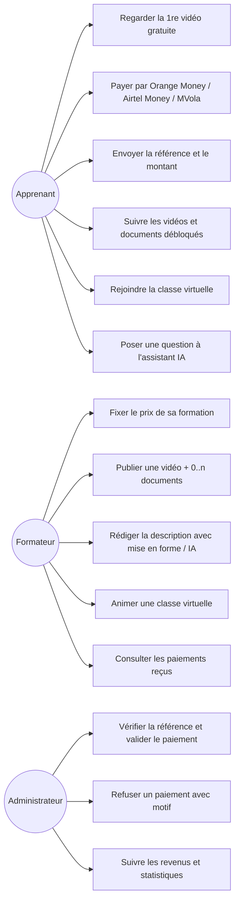
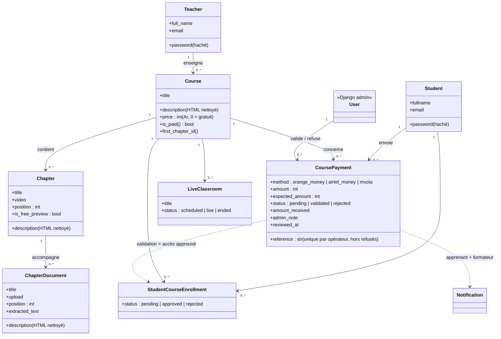
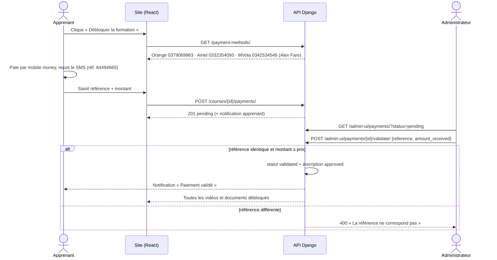

# Diagrammes UML — TCiD Center

Ces diagrammes décrivent le modèle de données et les flux ajoutés pour les
formations payantes, les documents par vidéo et la classe virtuelle.
Ils sont écrits en Mermaid (affichés directement par GitHub).

## Cas d'utilisation



## Diagramme de classes (extrait)



Règles d'accès :

- la première vidéo (ordre `position`) et les vidéos `is_free_preview` sont visibles par tous ;
- les autres vidéos et leurs documents exigent une inscription **approuvée** ;
- formation payante : l'inscription est approuvée **uniquement** par la validation du paiement par l'administrateur ;
- formation gratuite : le formateur approuve les demandes d'accès comme avant.

## Séquence — paiement d'une formation



## Séquence — classe virtuelle (WebRTC)

```mermaid
sequenceDiagram
    participant N as Nouveau participant
    participant S as Serveur (WebSocket)
    participant E as Participant déjà présent
    participant T as Relais TURN (coturn)

    N->>N: Test caméra/micro (une seule demande getUserMedia)
    N->>S: POST /join → jeton + serveurs ICE (STUN + TURN temporaire)
    N->>S: WebSocket connect
    S-->>E: participant_joined
    E->>E: addTransceiver(audio) + addTransceiver(video)
    E->>S: offer
    S-->>N: offer
    N->>N: setRemoteDescription puis replaceTrack(piste locale)
    N->>S: answer + candidats ICE
    S-->>E: answer + candidats ICE
    E-->>N: média direct (P2P) ou via T si NAT / réseau mobile
    Note over E,N: échec ICE → restartIce automatique ; coupure WebSocket → reconnexion automatique
```
